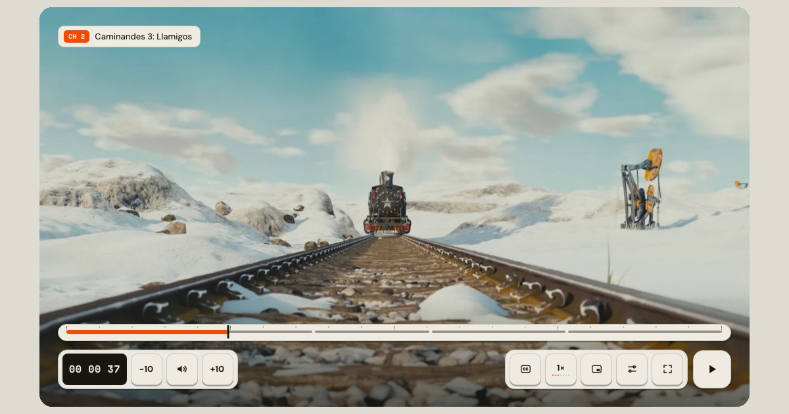

# FIELD — a Video.js 10 skin built like a field recorder



FIELD is a custom skin for [Video.js 10](https://videojs.org): putty keys over the picture, a tape counter for time, and a thumb-wheel you roll for volume. While you watch, all of it steps out of the way.

**Live site:** https://field-skin.netlify.app

Made for the Video.js v10 Skins Design Challenge (Contra × Mux). Designed by Zazzy ([@zazzygfx](https://x.com/zazzygfx)).

## What's in it

- **Left = where, right = what.** Tape counter, ±10 and volume on the left; captions, speed, PiP, settings and fullscreen on the right; a big play key that sinks like a tape deck.
- **Thumb-wheel volume** that unrolls in place from the volume key (ten detents, drag, scroll or ↑/↓). On iPhone and iPad the key mutes; the side buttons set the level.
- **Speed key** with a label and a hold-tray of seven speeds; **seek hover** with a ghost needle, tag and storyboard frame; **pause shelf** with chapters.
- **20 states** (ready, loading, scrubbing, live, behind live, error, no chapters, no captions, PiP, more contrast, calm, …) — see `SPEC.md` §10.
- **Fluid sizes** by the player's own width (container queries): XL / M / S / XS. Keys fold away; they never shrink below a thumb.
- **Themes:** Putty, Ink, Liquid, Holiday Snow, Holiday Pine, plus your own accent with a contrast guard.
- **Document Picture-in-Picture** in Chrome / Edge, native PiP elsewhere.
- **Accessible:** keyboard for everything, visible focus, 44 px+ targets, screen-reader names, reduced motion, reduced transparency, more contrast and forced colours. axe: 0 violations; Lighthouse Accessibility 100 (reports in `docs/audit/`).

## Install

```bash
npm install @videojs/html @videojs/mux-video
```

FIELD is an ejected Video.js 10 HTML skin: markup, one stylesheet and a small script.

1. Copy `tokens.css`, `src/field/` (stylesheet, icons and scripts) into your project.
2. Paste the player markup from `dev.html` (everything inside `<video-player>`), set your `src`.
3. Mount it:

```js
import '@videojs/html/video/player';
import '@videojs/html/media/mux-video';
import { mountField } from './field/field';

document.querySelectorAll('media-container.field').forEach(mountField);
```

Pick a theme with `data-field-theme="putty | ink | liquid | holiday-snow | holiday-pine"` on `media-container.field`, and an accent with `style="--field-accent: #FF4D00"`.

## Develop

```bash
npm install
npm run dev        # site at /, the player alone at /dev.html (Shift+D: 20 states + themes)
npm run build      # production build in dist/
node scripts/audit.mjs http://localhost:4173   # axe, keyboard, reduced motion/transparency, forced colours
```

## Credits

- Film: *[Caminandes 3: Llamigos](https://www.caminandes.com/)* © Blender Foundation, [CC BY 3.0](https://creativecommons.org/licenses/by/3.0/)
- Streaming by [Mux](https://www.mux.com). Built on [Video.js 10](https://videojs.org).
- Fonts: DM Sans and Space Mono, SIL Open Font License 1.1.

## Licence

[Apache 2.0](LICENSE) © 2026 Zazzy
